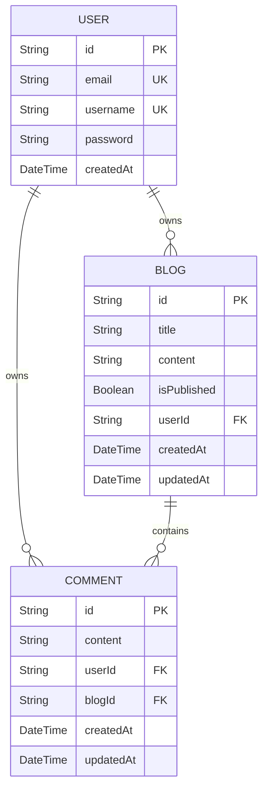
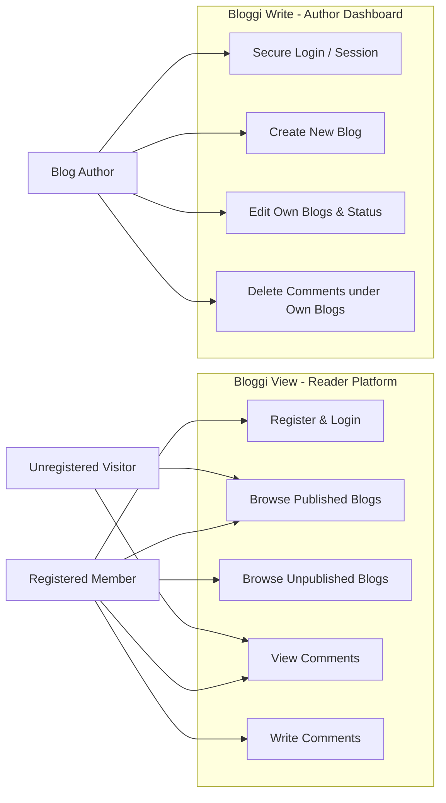

# Bloggi

Bloggi is a web application that allows unregistered user to view published blogs, registered user to view both published and unpublished blogs and leave comments on Bloggi View. And allows registered user to write and edit blogs ,and delete comments of their blogs on Bloggi Write. The front-end is separated into two sites(View and Write) as a form of self-challenge.

---

## Table of Contents

- [Features](#features)
- [Tech Stack](#tech-stack)
- [Project Structure](#project-structure)
- [Database Architecture](#database-architecture)
- [Application Routes](#application-routes)
- [Roadmap](#roadmap)

---

## Features

### Back-end

**Unregistered User (Visitor)**: Can only read published content.
**Registered User (Member)**: Can interact with content (commenting) and read both un/published content.
**Author (Blog Owner)**: Has full control over their own content and associated interactions.

### Bloggi View

- **For Unregistered Users:**
  - **Blog Feed**: Browse and read all published content.
  - **Comment Section**: View comments left by other users under each blog post.
- **For Registered Users (All the above plus):**
  - **Exclusive Feed**: View both all published and unpublished blogs .
  - **Engagement**: Leave comments on any blog post.

### Bloggi Write

- **Authentication**: Secure login/logout and session management to protect the workspace.
- **Blog Management (CRUD)**:
  - **Create**: Write new blogs with a title ,content and status of "Unpublished" or "Published".
  - **Update**: Update existing blogs' (both published and unpublished) content and status.
- **Comment Management**:
  - **Deletion**: Delete any comment under own blogs.

---

## Tech Stack

### Back-end

| Layer      | Technology         |
| ---------- | ------------------ |
| Runtime    | Node.js (ESM)      |
| Framework  | Express 5          |
| ORM        | Prisma 7           |
| Database   | PostgreSQL         |
| Auth       | JWT & Passport-jwt |
| Hash       | bcryptjs           |
| Security   | cors               |
| Validation | express-validator  |

### Front-end (Bloggi View & Bloggi Write)

| Layer       | Technology       |
| ----------- | ---------------- |
| Runtime     | Node.js (ESM)    |
| Framework   | React/Vite       |
| HTTP Client | axios            |
| Styling     | Tailwind CSS     |
| Routing     | React Router DOM |
| Validation  | validator.js     |

---

## Project Structure

```
Bloggi/
├── .gitignore
├── README.md
│
├── backend/
│   ├── package.json
│   ├── server.js
│   ├── app.js
│   ├── prisma/
│   │   └── schema.prisma
│   └──src/
│       ├── config/
│       ├── controllers/
│       ├── db/
│       ├── middlewares/
│       ├── routes/
│       ├── lib/
│       └── validators/
│
├── frontend-view/
│   ├── package.json
│   ├── vite.config.js
│   ├── src/
│   │   ├── components/
│   │   ├── pages/
│   │   └── ...
│   └── ...
│
└── frontend-write/
    ├── package.json
    ├── vite.config.js
    ├── src/
    │   ├── components/
    │   ├── pages/
    │   └── ...
    └── ...

```

---

## Database Architecture

The system uses a 3-table relational schema designed to map out users, their comments and blogs.

### 1. UML Class Diagram





### 2. Table Specifications

#### User

Stores secure user credentials.

| Field       | Type     | Attributes      | Description                       |
| :---------- | :------- | :-------------- | :-------------------------------- |
| `id`        | String   | @id, UUID       | Unique user identifier            |
| `email`     | String   | @unique         | User login credential             |
| `username`  | String   | @unique         | Blog author, commenter identifier |
| `password`  | String   | Encrypted       | Hashed password string (Bcrypt)   |
| `createdAt` | DateTime | @default(now()) | Account registration timestamp    |

#### Blog

Stores blog title and contents.

| Field         | Type     | Attributes      | Description                                     |
| :------------ | :------- | :-------------- | :---------------------------------------------- |
| `id`          | String   | @id, UUID       | Unique blog identifier                          |
| `title`       | String   | -               | Custom blog title                               |
| `content`     | String   | -               | Author's content                                |
| `isPublished` | Boolean  | @default(false) | publish status, default 'false' for unpublished |
| `userId`      | String   | FK (User.id)    | Author identifier                               |
| `createdAt`   | DateTime | @default(now()) | Blog creation timestamp                         |
| `updatedAt`   | DateTime | @updatedAt      | Blog update timestamp                           |

#### Comment

Stores comments content. Cascade deletion for all child comments if parent blog is deleted.

| Field       | Type     | Attributes      | Description                |
| :---------- | :------- | :-------------- | :------------------------- |
| `id`        | String   | @id, UUID       | Unique comment identifier  |
| `content`   | String   | -               | Comment content            |
| `userId`    | String   | FK (User.id)    | Commenter identifier       |
| `blogId`    | String   | FK (Blog.id)    | Parent blog                |
| `createdAt` | DateTime | @default(now()) | comment creation timestamp |
| `updatedAt` | DateTime | @updatedAt      | comment update timestamp   |

---

## Application Routes

To secure operations across both Bloggi-View and Bloggi-Write, the backend implements JWT and Passport.js (`passport-jwt` strategy).

- **Token Issue & Lifecycle**: Upon successful authentication, the backend issues a single JWT with a 12-hour expiration window. This specific timeframe is chosen to ensures users are prompted to re-authenticate daily as this project is not able to implement Dual Token Mechanism.
- **Token Transmission**: For any protected routes , the frontend client must attach this token to the HTTP request's `Authorization` header as a `Bearer` token.
- **Request Hydration**: The `passport-jwt` middleware intercepts these protected requests, verifies the token's signature, and automatically hydrates the Express `req.user` object with the authenticated user's credentials.

### Back-end

#### Authentication

| Method | Endpoint           | Access | Description                                                            |
| :----- | :----------------- | :----- | :--------------------------------------------------------------------- |
| `POST` | `/api/auth/signup` | Public | Registers a new user, hashes the password, and creates a record in DB. |
| `POST` | `/api/auth/login`  | Public | Validates user credentials and issues a signed JWT valid for 12 hours. |

#### Blog Management

| Method   | Endpoint               | Access      | Description                                                                       |
| :------- | :--------------------- | :---------- | :-------------------------------------------------------------------------------- |
| `GET`    | `/api/blogs`           | Dynamic     | Return published blogs if visitor, or all blogs if authenticated for bloggi view. |
| `GET`    | `/api/dashboard/blogs` | Auth (User) | Return all blogs of user for bloggi write.                                        |
| `GET`    | `/api/blogs/:id`       | Dynamic     | Return blog and all its comments.                                                 |
| `POST`   | `/api/blogs`           | Auth (User) | Creates a new blog post (unpublished or published)                                |
| `PUT`    | `/api/blogs/:id`       | Auth(Owner) | Updates an existing blog                                                          |
| `DELETE` | `/api/blogs/:id`       | Auth(Owner) | Deletes blog and triggers Prisma cascade comment purge                            |

#### Comment Management

| Method | Endpoint | Access | Description |
| :----- | :-------------------- | :------------ | :------------------------------------------------------------------------------------------------------ | |
| `POST` | `/api/blogs/:id/comments` | Auth (User) | Stores members comments on a particular blog. |
| `DELETE` | `/api/comments/:id` | Auth(Blog Author) | Deletes a comment. Restricted to the blog owner. |

### Front-end (Bloggi View)

| Path        | Access / Guard  | Component / Page Description                                                                         |
| :---------- | :-------------- | :--------------------------------------------------------------------------------------------------- |
| `/`         | Dynamic         | Displays the blog list grid,different blogs for visitors and members.                                |
| `/login`    | Unauthed Only   | Validates login.                                                                                     |
| `/logout`   | Protected Guard | Clears client-side tokens and redirects to login.                                                    |
| `/signup`   | Unauthed Only   | Handles account creation form rendering and preliminary validation.                                  |
| `/blog/:id` | Dynamic         | Displays full text and the comment section. Members will also see additional section for commenting. |

---

### 3. Front-end (Bloggi Write)

| Path              | Access / Guard  | Component / Page Description                          |
| :---------------- | :-------------- | :---------------------------------------------------- |
| `/login`          | Unauthed Only   | Workspace entry point.                                |
| `/logout`         | Protected Guard | Clears client-side tokens and redirects to login.     |
| `/dashboard`      | Protected Guard | Lists all blogs owned by the author with quick stats. |
| `/blog/:id`       | Protected Guard | See details of the blog and its comments.             |
| `/write/new`      | Protected Guard | Editor to create a new blog post.                     |
| `/write/edit/:id` | Protected Guard | Editor to update an existing blog post.               |

---

## Roadmap

Phase 1: Backend & Database Foundation

• Create folder structure and configure the global .gitignore.
• Initialize Prisma Schema, define relationships, and push to PostgreSQL.
• Implement user registration (/signup) with Bcrypt password hashing.
• Implement login (/login) and configure Passport-JWT to issue 12h tokens.
• Configure global cors middleware in Express to accept dual-frontend ports.
• Verify all Auth endpoints via Postman.

Phase 2: Core RESTful APIs & Permissions

• Implement Blog CRUD routes (handling draft vs. published filtering logic).
• Implement Comment creation and comment deletion API.
• Secure routes with JWT middleware (Auth Required guard).
• Inject strict ownership checks in controllers (preventing unauthorized PUT/DELETE).
• Verify all data endpoints and error responses via Postman.

Phase 3: Bloggi View (Reader App)

• Scaffold Vite/React project and set up Tailwind CSS.
• Implement Axios instance with request interceptors to automatically attach JWT.
• Build Home feed (/) and Blog detail page (/blog/:id) with Dynamic fetching.
• Implement Sign-up, Sign-in, and full Client-side Token management.
• Add conditional UI rendering (hiding comment form for unauthenticated guests).

Phase 4: Bloggi Write (Author App)

• Scaffold the second Vite/React project.
• Build the global <ProtectedRoute /> wrapper component for route guarding.
• Connect Dashboard (/dashboard) to fetch current user's blogs only.
• Build workspace Editor components for both creating (/write/new) and editing (/write/edit/:id).
• Integrate comment deletion triggers on the post detail view.

The following features are planned for future releases:

- **Admin role** — Admins will have access to detailed statistics, user management, and advanced settings.

---
